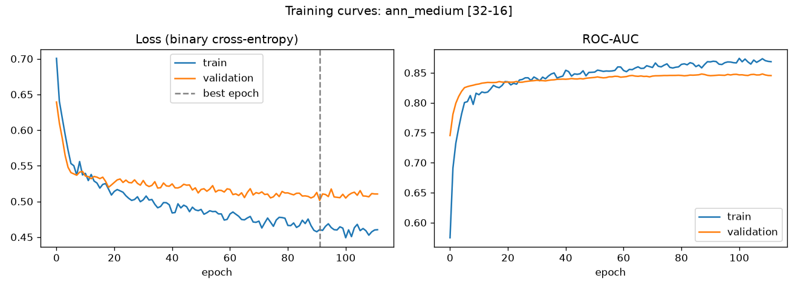

# Credit Risk Prediction with an Artificial Neural Network

Predicts whether a loan applicant will **default** ("bad" credit status) from application data. A Keras ANN is compared against a Logistic Regression baseline.

**Dataset:** Credit Scoring dataset ([gastonstat/CreditScoring](https://github.com/gastonstat/CreditScoring)): 4,446 applicants from a Spanish bank, 15 features, **28.1% defaulters** (imbalanced).

## Pipeline

1. **Cleaning.** Dropped the pre-binned duplicate columns. Engineered `loan_to_income = Amount / Income`.
2. **Split.** Stratified 70 / 15 / 15 into train, validation and test (3,112 / 667 / 667), seed 42.
3. **Preprocessing.** A `ColumnTransformer` fitted on the training set only:
   - `StandardScaler` on the numeric columns;
   - `log1p` and then scaling on the skewed `Assets` and `Debt`;
   - one-hot encoding of Home, Marital, Records and Job.

   The result is 29 input features.
4. **Imbalance.** Balanced class weights (`{0: 0.70, 1: 1.78}`) for both models.
5. **ANN.** Three architectures were compared on validation ROC-AUC. Each was trained with:
   - ReLU hidden layers;
   - Dropout 0.3 and L2 1e-4;
   - a sigmoid output;
   - Adam (lr 1e-3), binary cross-entropy, batch size 64;
   - **early stopping** on validation loss (patience 20, restore best weights).
6. **Threshold.** Chosen on the validation set to maximise F1. The test set is used once, at the end.

## Results

**Architecture selection (validation set)**

| Model | Hidden layers | Params | Best epoch | Val ROC-AUC |
|---|---|---|---|---|
| Logistic Regression | – | 30 | – | 0.826 |
| ANN small | 16 | 497 | 70 | 0.839 |
| **ANN medium** | **32 → 16** | **1,505** | **92** | **0.845** |
| ANN large | 64 → 32 → 16 | 4,545 | 24 | 0.838 |

**Final test set (667 applicants, 187 defaulters)**

| Model | ROC-AUC | PR-AUC | Accuracy | Precision | Recall | F1 |
|---|---|---|---|---|---|---|
| Logistic Regression | 0.859 | 0.692 | 78.0% | 58.2% | **75.9%** | 0.659 |
| **ANN [32-16]** | **0.864** | **0.694** | **80.7%** | **64.6%** | 68.4% | **0.665** |



## Findings

- **Deeper is not better.** The 3-layer network overfit early (best epoch 24) and scored lower than the 2-layer one. On 3k rows of tabular data, a small network with dropout and early stopping works best.
- **The ANN beats the baseline, but only by a little.** Its test ROC-AUC is +0.005 over the baseline. Its operating point is more precise: 70 false alarms against 102, at the cost of 13 more missed defaulters. Logistic Regression is still a strong, interpretable baseline on tabular data, and that is worth knowing before reaching for deep learning.
- **About 65% of flagged applicants really default,** 2.3× the 28% base rate. The ANN catches 68% of all defaulters.
- **Early stopping did its job.** The train loss keeps falling while the validation loss flattens around epoch 90 (see the curves above), and the best weights are restored from that point.
- **The threshold is a business decision.** A missed defaulter usually costs a lender more than a rejected good customer. Lowering the threshold trades precision for recall.

## Run

Tested with Python 3.13 (versions pinned in `requirements.txt`).

```bash
pip install -r requirements.txt
python src/download_data.py   # data is already included in data/
python src/train_ann.py       # ~1 min on CPU
```

**Outputs** (in `results/`):
- `validation_comparison.csv`
- `test_metrics.csv`
- `best_ann.json`
- `best_ann.keras`
- `figures/learning_curves.png`

## Structure

```
data/CreditScoring.csv   raw dataset (4,446 rows)
src/download_data.py     re-downloads the dataset
src/prepare.py           load, clean, feature engineering, split, preprocessing
src/train_ann.py         LR baseline, ANN architecture search, evaluation, plots
results/                 metrics, saved model, figures
```

## Data source

Credit Scoring data from [gastonstat/CreditScoring](https://github.com/gastonstat/CreditScoring). It is included here for reproducibility.
